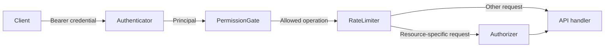

# Xác thực & Phân quyền (Authentication & Authorization)

Tài liệu này giải thích cách hoạt động của hạ tầng xác thực (auth) trong Parlant và cách thiết lập từng bước — bao gồm cả việc kết nối nó với cơ sở dữ liệu khách hàng hiện có của bạn.

## Các khái niệm then chốt

Bạn không cần phải là một chuyên gia mật mã học để cấu hình xác thực trong Parlant. Ý tưởng cốt lõi là người gọi (caller) xuất trình một thông tin xác thực (credential), Parlant xác minh người gọi đó là ai, và sau đó quyết định độc lập xem người gọi đó được phép làm những gì.

### Điều gì xảy ra với một yêu cầu đã được xác thực



Xét theo khía cạnh thực tế:

1. Client gửi một credential trong HTTP header `Authorization: Bearer <credential>`. Credential đó có thể là một admin API key, một Parlant guest token, hoặc một customer JWT.
2. **Authenticator** xác minh credential và phân giải nó thành một **principal**: anonymous, guest, customer, hoặc admin. Đây là **xác thực (authentication)** — xác định xem ai đang gọi.
3. **Permission gate** kiểm tra xem loại principal đó có được phép thực hiện thao tác được yêu cầu hay không. Đây là phần đầu tiên của **phân quyền (authorization)** — xác định người gọi được phép làm gì.
4. **Rate limiter** kiểm tra xem người gọi có đang thực hiện thao tác đó quá thường xuyên hay không.
5. Đối với một thao tác trên một phiên (session) cụ thể, **authorizer** sẽ kiểm tra xem principal có sở hữu tài nguyên đó hay không. Ví dụ: một khách hàng hợp lệ có thể đọc session của chính mình nhưng không thể đọc session của khách hàng khác.

Xác thực (authentication) và phân quyền (authorization) được tách biệt có chủ đích. Một token có thể hoàn toàn hợp lệ nhưng hành động được yêu cầu vẫn bị cấm; sự khác biệt đó là lý do tại sao xác thực thất bại trả về HTTP 401 trong khi phân quyền thất bại trả về HTTP 403.

### Token, chữ ký và khóa (keys)

| Thuật ngữ | Ý nghĩa ở đây |
|---|---|
| **Bearer credential** | Một giá trị mà client gửi kèm theo mỗi request. "Bearer" có nghĩa là việc sở hữu nó là đủ điều kiện để sử dụng, vì vậy nó phải được bảo vệ trong quá trình truyền tải và khi lưu trữ. Đây là quy ước truyền tải (transport convention), không phải định dạng token: cả JWT và static admin key đều được gửi theo cách này. |
| **JWT (JSON Web Token)** | Một token nhỏ gọn chứa header, tập hợp các claims và chữ ký (signature). Parlant sử dụng JWT cho customer và guest. Các JWT được mô tả ở đây được ký (signed), không phải mã hóa (encrypted); các claim của chúng có thể được giải mã bởi người nắm giữ và không được chứa dữ liệu bí mật (secrets). |
| **Claim** | Một trường bên trong JWT. Parlant yêu cầu `sub` làm định danh customer hoặc guest, kiểm tra `exp` khi nó xuất hiện, và dùng `typ` để phân biệt các guest token của chính nó. Các claim khác được sao chép vào `Principal.attributes` cho các permission gate và authorizer tùy chỉnh. Customer token phải luôn có thời hạn ngắn. |
| **Signature (Chữ ký)** | Bằng chứng mã hóa chứng minh rằng một bên phát hành đáng tin cậy đã tạo ra token và nội dung của nó chưa bị thay đổi. Chữ ký bảo vệ tính toàn vẹn (integrity) và tính xác thực (authenticity), không bảo vệ tính bảo mật (confidentiality). Parlant từ chối token nếu chữ ký hoặc thời hạn của nó không hợp lệ. |
| **HMAC / HS256, HS384, HS512** | Phương thức ký đối xứng: bên phát hành và Parlant chia sẻ cùng một khóa bí mật (secret), khóa này được dùng cho cả việc ký và xác minh token. Cấu hình luồng customer-token này bằng `customer_jwt_secret`. Parlant cũng ký các guest token bằng HS256 sử dụng `guest_token_secret`. |
| **Asymmetric signing / RS256 hoặc ES256** | Bên phát hành ký bằng private key và Parlant xác minh bằng public key tương ứng. Private key không bao giờ cần phải chia sẻ với Parlant. Thuật toán RSA sử dụng tiền tố `RS`; thuật toán đường cong elliptic sử dụng tiền tố `ES`. |
| **JWKS (JSON Web Key Set)** | Tài liệu JSON chứa các public key xác minh của bên phát hành. Với `customer_jwks_url`, Parlant đọc key ID của token, lấy public key tương ứng từ URL đó và xác minh các customer JWT được ký bằng RS hoặc ES. Đây là lựa chọn phổ biến khi một identity provider (IdP) hiện có phát hành token và xoay vòng (rotate) các khóa của nó. |
| **Identity provider (IdP)** | Hệ thống đăng nhập người dùng và cấp phát thông tin xác thực, chẳng hạn như nhà cung cấp OIDC/SSO hoặc backend của chính bạn. Parlant không phải là một IdP: nó chỉ tin tưởng danh tính khách hàng sau khi xác minh token do hệ thống của bạn phát hành. |
| **TTL và hạn sử dụng (expiration)** | Thời gian sống (time to live) của token. Claim `exp` làm cho JWT ngừng hoạt động sau một thời điểm nhất định. Thời gian sống của customer-token ngắn giúp hạn chế rủi ro lộ lọt; frontend nhận token thay thế từ hệ thống định danh của bạn, không phải từ Parlant. |
| **Thu hồi (Revocation) và xoay vòng khóa (key rotation)** | Các cách để vô hiệu hóa thông tin xác thực. Parlant không lưu danh sách chặn (block-list) customer-token và không tham vấn danh sách thu hồi của IdP. Sử dụng thời hạn ngắn hoặc xoay vòng/xóa signing key để vô hiệu hóa JWT đã cấp; sử dụng một `Authenticator` kiểm tra nội quan (introspecting) tùy chỉnh nếu từng token riêng lẻ cần được thu hồi ngay lập tức. JWKS cho phép IdP xuất bản các public key mới trong quá trình xoay vòng. |
| **API key** | Thông tin xác thực admin tĩnh được cấu hình dưới dạng `admin_api_key`. Nó không phải là JWT và không có claim hay hạn sử dụng tích hợp sẵn. Hãy xử lý nó như mật khẩu cơ sở dữ liệu và chỉ sử dụng từ các backend đáng tin cậy. |

Có hai cách thay thế để xác minh customer JWT:

- Sử dụng **HMAC** khi backend của bạn tạo ra một token Parlant chuyên dụng và có thể chia sẻ signing secret một cách an toàn với Parlant.
- Sử dụng **JWKS** khi một IdP hiện có đã phát hành các JWT bất đối xứng. IdP giữ lại private key của nó và Parlant chỉ cần endpoint JWKS công khai.

Các lựa chọn này chỉ áp dụng cho customer token. Parlant luôn tạo guest token của riêng mình bằng HS256, trong khi credential của admin là static API key.

### Các thuật ngữ sử dụng trong tích hợp nâng cao

| Thuật ngữ | Vị trí áp dụng |
|---|---|
| **RBAC (role-based access control)** | Cấp quyền thao tác theo các vai trò như support agent hoặc auditor. Triển khai bằng cách thay thế `PermissionGate` và đọc roles từ `Principal.attributes`. |
| **Scope** | Một token claim đặt tên cho một năng lực được phép, ví dụ `sessions:read`. Một `PermissionGate` tùy chỉnh có thể thực thi các scope thay cho hoặc song song với roles. |
| **OIDC / SSO** | Các hệ thống định danh và đăng nhập phổ biến xác thực người dùng và thường phát hành các JWT đã ký. Cấu hình JWKS URL của chúng khi token đã có sẵn `sub` phù hợp, hoặc điều chỉnh chúng bằng một `Authenticator` tùy chỉnh. |
| **mTLS** | Mutual TLS, nơi client cũng xuất trình chứng chỉ trong quá trình bắt tay TLS. Việc hỗ trợ nó đòi hỏi một `Authenticator` tùy chỉnh để chuyển đổi định danh chứng chỉ đã xác minh thành principal. |
| **Opaque token và introspection** | Opaque token là một định danh không có các claim có thể xác minh cục bộ. Introspection có nghĩa là hỏi bên phát hành xem token có hợp lệ không và nó đại diện cho ai. Điều này cũng đòi hỏi một `Authenticator` tùy chỉnh. |

## Mô hình (The model)

Parlant phân biệt ba câu hỏi, được trả lời bởi ba ports có thể hoán đổi:

| Câu hỏi | Port | Mặc định |
|---|---|---|
| **Ai đang gọi?** | `Authenticator` | `TokenAuthenticator` — stateless bearer tokens |
| **Loại người gọi này có được làm thao tác này không?** | `PermissionGate` | `DefaultPermissionGate` — danh sách cho phép (allowlist) theo từng principal |
| **Người gọi này có được động vào tài nguyên cụ thể này không?** | `Authorizer` | `OwnershipAuthorizer` — quyền sở hữu phiên (session ownership) |

Mỗi request đều phân giải thành chính xác một **`Principal`**:

- **`AnonymousPrincipal`** — không có credentials. Chỉ có thể đọc thông tin agent và bắt đầu cuộc hội thoại guest.
- **`GuestPrincipal`** — một trình duyệt chưa xác định danh tính đang nắm giữ một guest token do Parlant phát hành. Tất cả các guest đều chia sẻ singleton customer `guest`, nhưng mỗi guest token mang một `guest_instance_id` ngẫu nhiên để giới hạn phạm vi trong *các phiên mà nó đã tạo*. Một guest không bao giờ có thể đọc cuộc trò chuyện của một guest khác.
- **`CustomerPrincipal`** — một khách hàng cụ thể, được chứng minh bằng JWT mà backend của **bạn** đã tạo (Parlant chỉ xác minh nó). Phạm vi được giới hạn trong các session của chính khách hàng đó.
- **`AdminPrincipal`** — toàn quyền truy cập API (tạo entity, cấu hình, mọi thứ), được chứng minh bằng static API key.

Các Principal cũng mang theo một bản đồ `attributes` mở (các claims của JWT), mà các custom gates/authorizers có thể tham vấn — các giá trị mặc định sẽ bỏ qua các attributes không xác định.

### Vòng đời định danh Guest (Guest identity lifecycle)

Các client không có tài khoản khách hàng sẽ tham gia vào cuộc hội thoại guest thông qua vòng đời định danh hai giai đoạn. Trước khi Parlant cấp phát bất kỳ thông tin xác thực nào, client là anonymous và các request không thể được liên kết với nhau. Khi Parlant cấp guest token, client sẽ có một định danh giả danh (pseudonymous identity) ổn định mà không cần trở thành một khách hàng đã đăng nhập, đã biết danh tính.

Vòng đời bắt đầu như sau:

1. Một trình duyệt mới gọi `POST /sessions` mà không có header `Authorization`, vì vậy request phân giải thành `AnonymousPrincipal`.
2. Parlant tạo một `guest_instance_id` mới, tạo session dưới customer `guest` dạng singleton, và trả về một guest token trong response header `X-Parlant-Guest-Token`.
3. Trình duyệt lưu trữ token đó và gửi nó dưới dạng `Authorization: Bearer <token>` trên các request tiếp theo.
4. Những request đó phân giải thành `GuestPrincipal`. Guest có thể đọc và nhắn tin trong các session được tạo bằng token của nó, và có thể tạo thêm các session mới thuộc sở hữu của cùng định danh guest đó.
5. Khi token đã đi qua hơn một nửa thời gian sống của nó, bất kỳ phản hồi nào trả về cho guest đều kèm theo một token được gia hạn cho **cùng** `guest_instance_id` đó trong header `X-Parlant-Guest-Token`. Trình duyệt lưu trữ nó thay thế cho token cũ và giữ lại các session của mình. Việc gia hạn dừng lại khi định danh đạt đến độ tuổi tối đa (`PARLANT_GUEST_IDENTITY_MAX_AGE_DAYS`, mặc định là 28 ngày, tính từ thời điểm định danh được tạo lần đầu); sau đó, token hết hạn sẽ bị từ chối và trình duyệt bắt đầu lại như một guest mới.

Những người gọi ẩn danh (Anonymous) không thể truy cập bất kỳ session hiện có nào, ngay cả khi họ biết ID của session. Người gọi Guest chỉ có thể truy cập các session được gắn tag bằng `guest_instance_id` của chính họ; họ không thể truy cập session của guest khác hoặc session của một khách hàng có tên cụ thể. Mặc dù mọi session của guest đều có `customer_id="guest"`, nhưng instance ID bí mật chính là thứ thiết lập quyền sở hữu giữa các trình duyệt guest khác nhau.

Một token bị thiếu sẽ phân giải thành `AnonymousPrincipal`. Một token hiện diện nhưng không hợp lệ, bị giả mạo hoặc hết hạn sẽ thất bại ở bước xác thực với mã HTTP 401; nó không tự động hạ cấp trong im lặng về anonymous.

### Tính phi trạng thái (Statelessness) — tại sao không có refresh tokens

Parlant **hoàn toàn không lưu trạng thái token**. Mỗi request được đánh giá duy nhất dựa trên token mà nó xuất trình:

- Customer token được cấp phát, làm mới (refresh) và hết hạn bởi các hệ thống của **bạn**. Parlant không thể "chặn" một khách hàng: một token hết hạn sẽ bị từ chối với 401, và ngay request tiếp theo với token mới sẽ thành công.
- Guest token được ký (HS256) bởi Parlant với TTL có thể cấu hình (mặc định là một tuần) — không có bản ghi session phía server. Token của guest quay trở lại cũng được gia hạn theo cách phi trạng thái: token được gia hạn mang thời điểm bắt đầu ban đầu của định danh (`identity_iat`), giúp giới hạn thời gian gia hạn có thể tiếp tục.
- Việc thu hồi (Revocation), khi bạn cần, nằm trong hệ thống định danh của *bạn* (TTL ngắn, xoay vòng khóa), không nằm trong block-list của Parlant.

### Các mã trạng thái HTTP

- **401 Unauthorized** — thông tin xác thực không vượt qua được kiểm tra (chữ ký sai, hết hạn, khách hàng không tồn tại).
- **403 Forbidden** — định danh hợp lệ, nhưng thao tác hoặc tài nguyên không được phép (ví dụ: khách hàng đọc session của khách hàng khác).
- **429 Too Many Requests** — vượt quá giới hạn tần suất (mặc định theo IP của client; admin được miễn trừ).

---

## Khởi đầu nhanh (SDK)

```python
import parlant.sdk as p

async with p.Server(
    auth=p.AuthConfig(
        admin_api_key="your-long-random-admin-key",
        customer_jwt_secret="secret-shared-with-your-backend",  # HS256
        guest_token_secret="another-long-random-secret",
        auto_provision_customers=False,
    ),
) as server:
    ...
```

Đây là toàn bộ thiết lập. API hiện thực thi mô hình guest/customer/admin được mô tả ở trên.

Các trường của `AuthConfig`:

| Trường | Ý nghĩa |
|---|---|
| `admin_api_key` | Khóa tĩnh để truy cập toàn bộ API. **Bắt buộc.** |
| `customer_jwt_secret` | Shared HMAC secret để xác minh customer JWT từ backend của bạn (HS256/384/512). |
| `customer_jwks_url` | *Lựa chọn thay thế* cho shared secret: JWKS URL của IdP của bạn cho các asymmetric JWT (RS256/ES256, v.v.). Không thể dùng đồng thời với `customer_jwt_secret`. |
| `guest_token_secret` | Khóa bí mật cho các guest token do Parlant tạo. Nếu bỏ trống, một khóa tạm thời sẽ được sinh ra khi khởi động; khi đó các guest token sẽ ngừng hoạt động khi server khởi động lại, tức là việc restart sẽ đăng xuất tất cả các guest. |
| `guest_identity_max_age_seconds` | Khoảng thời gian một guest quay trở lại có thể duy trì một định danh (và do đó duy trì các session của mình) thông qua việc gia hạn token. Mặc định là 4 tuần. |
| `auto_provision_customers` | Nếu là `True`, một customer JWT hợp lệ có `sub` chưa phải là một customer trong Parlant sẽ tự động tạo customer đó trong lần tương tác đầu tiên. Mặc định là `False` (khách hàng chưa biết sẽ bị từ chối với 401). |

Việc để trống cả `customer_jwt_secret` và `customer_jwks_url` sẽ vô hiệu hóa hoàn toàn tính năng xác thực khách hàng (chỉ cho phép guests + admin).

### Cấu hình thông qua biến môi trường

Thiết lập `PARLANT_ENV=production` sẽ khiến server đọc cùng cấu hình đó từ các biến môi trường và **dừng ngay khi khởi động (fail fast)** nếu thiếu admin key:

```bash
export PARLANT_ENV=production
export PARLANT_ADMIN_API_KEY="your-long-random-admin-key"          # bắt buộc
export PARLANT_CUSTOMER_JWT_SECRET="secret-shared-with-backend"    # hoặc:
# export PARLANT_CUSTOMER_JWKS_URL="https://idp.example.com/.well-known/jwks.json"
export PARLANT_GUEST_TOKEN_SECRET="another-long-random-secret"     # khuyến nghị
export PARLANT_GUEST_IDENTITY_MAX_AGE_DAYS=28                      # tùy chọn; giá trị mặc định
export PARLANT_AUTH_AUTO_PROVISION_CUSTOMERS=false
```

Nếu không có `PARLANT_ENV=production` (chế độ development), mọi thứ đều được phép — không cần thông tin xác thực. Không bao giờ để lộ server chạy ở chế độ development ra môi trường công khai.

---

## Từng bước: xác thực customer với cơ sở dữ liệu khách hàng hiện có của bạn

Parlant **không phải** là một identity provider. Backend của bạn đã biết ai đang đăng nhập; nó bảo lãnh cho danh tính đó bằng cách tạo ra một JWT nhỏ mà Parlant sẽ xác minh. Gồm ba bước:

### Bước 1 — Làm cho Parlant nhận biết khách hàng của bạn

Claim `sub` của JWT phải là một `CustomerId` của Parlant. Chọn MỘT trong các cách sau:

**(a) Đồng bộ hóa người dùng của bạn vào Parlant** (các id tường minh cho phép `sub` chính là user id của bạn):

```python
async with p.Server(auth=...) as server:
    agent = await server.create_agent(id="my-agent", name="Support", instructions=...)
    # ví dụ: trên webhook tạo người dùng của bạn, hoặc chạy đồng bộ một lần:
    await server.create_customer(name="Jane Doe", id="user_1234")
```

**(b) Tự động cấp phát (Auto-provision)** — đặt `auto_provision_customers=True` và bỏ qua bước đồng bộ: request đầu tiên với một JWT hợp lệ cho một `sub` chưa biết sẽ tạo customer (sử dụng claim `name` của JWT nếu có). Tốt nhất khi Parlant chỉ đóng vai trò là nơi lưu trữ hồ sơ hội thoại, không phải nơi quản lý hồ sơ khách hàng.

**(c) Sử dụng `CustomerStore` tùy chỉnh của riêng bạn** — nếu bạn muốn Parlant đọc hồ sơ khách hàng *trực tiếp từ cơ sở dữ liệu của bạn* thay vì sao chép chúng, hãy triển khai interface `CustomerStore` và cắm nó vào server:

```python
class MyDBCustomerStore(p.CustomerStore):
    async def read_customer(self, customer_id: p.CustomerId) -> Customer:
        row = await my_db.get_user(customer_id)
        if row is None:
            raise ItemNotFoundError(item_id=UniqueId(customer_id))
        return Customer(
            id=customer_id,
            creation_utc=row.created_at,
            modified_utc=row.updated_at,
            name=row.display_name,
            metadata={"tier": row.plan},
            groups=[],
        )
    # ...triển khai các phương thức CustomerStore còn lại...

async with p.Server(
    customer_store=MyDBCustomerStore(),
    auth=p.AuthConfig(...),
) as server:
    ...
```

Lưu ý sự phân tách: **định danh (identity)** (`customer_id` đã xác minh) đến từ token; **hồ sơ (profile)** (tên, hạng mức tier, metadata dùng cho cá nhân hóa) đến từ `CustomerStore`. Hãy giữ hai phần này tách biệt.

### Bước 2 — Tạo một JWT trong backend của bạn

Sau khi luồng đăng nhập của *bạn* xác định được người dùng là ai, hãy tạo một token ngắn hạn (bất kỳ thư viện JWT nào cũng hoạt động; đây là PyJWT):

```python
import time, jwt

def make_parlant_token(user_id: str, display_name: str) -> str:
    return jwt.encode(
        {
            "sub": user_id,                    # CustomerId của Parlant
            "name": display_name,              # được dùng khi auto-provision
            "exp": int(time.time()) + 15 * 60, # chính sách của bạn
        },
        PARLANT_CUSTOMER_JWT_SECRET,           # shared secret từ Bước 1
        algorithm="HS256",
    )
```

Giao token này cho frontend của bạn (nhúng vào trang bootstrap hoặc mở một endpoint `/chat-token` nhỏ để frontend gọi). Khi nó hết hạn, frontend sẽ lấy một token mới từ *bạn* — Parlant không có quy trình làm mới token.

Nếu bạn đã chạy một IdP/SSO phát hành các JWT RS256/ES256, hãy bỏ qua bước tạo token: trỏ `customer_jwks_url` vào JWKS endpoint của bạn và truyền access token hiện có, miễn là `sub` của nó ánh xạ tới một `CustomerId` trong Parlant.

### Bước 3 — Gọi Parlant từ trình duyệt

```javascript
// tạo một phiên gắn với khách hàng của token (không có customer_id trong body!)
const session = await fetch(`${PARLANT_URL}/sessions`, {
    method: "POST",
    headers: {
        "Authorization": `Bearer ${parlantToken}`,
        "Content-Type": "application/json",
    },
    body: JSON.stringify({ agent_id: AGENT_ID }),
}).then(r => r.json());

// gửi tin nhắn
await fetch(`${PARLANT_URL}/sessions/${session.id}/events`, {
    method: "POST",
    headers: { "Authorization": `Bearer ${parlantToken}`, "Content-Type": "application/json" },
    body: JSON.stringify({ kind: "message", source: "customer", message: "Hi!" }),
});

// thăm dò phản hồi của agent
const events = await fetch(
    `${PARLANT_URL}/sessions/${session.id}/events?min_offset=0&wait_for_data=30`,
    { headers: { "Authorization": `Bearer ${parlantToken}` } },
).then(r => r.json());
```

`customer_id` của session luôn được lấy từ token. Một `customer_id` trong request body mâu thuẫn với token sẽ bị từ chối với 403. Khách hàng chỉ có thể tạo, đọc và đăng bài vào **chính các session của họ**.

---

## Luồng Guest (không cần đăng nhập)

Đối với khách truy cập không có tài khoản, hoàn toàn không cần thực hiện công việc backend nào:

1. Trình duyệt gọi `POST /sessions` mà **không** có header `Authorization`.
2. Parlant tạo một session cho customer `guest` và trả về một guest token mới được tạo trong response header **`X-Parlant-Guest-Token`**.
3. Trình duyệt lưu trữ token đó (ví dụ: `localStorage`) và gửi nó dưới dạng `Authorization: Bearer <token>` trên các request tiếp theo — bao gồm cả việc tạo *các session bổ sung*, những session này cũng sẽ thuộc về cùng một guest.
4. Bất cứ khi nào một response mang `X-Parlant-Guest-Token`, trình duyệt sẽ thay thế token đã lưu trữ bằng token đó. Đây là một sự gia hạn cho cùng một guest.

Một guest chỉ có thể thao tác với các session mà token của chính nó đã tạo: session của các guest khác và tất cả session của customer sẽ trả về 403. Một request hoàn toàn không có token cũng sẽ nhận 403 đối với một session hiện có, vì vậy client làm mất token nên bắt đầu một session mới thay vì thử lại.

Guest token có hiệu lực trong một tuần (`TokenAuthenticator(guest_token_ttl_seconds=...)` để thay đổi). Một guest quay trở lại trong vòng một tuần đó sẽ được gia hạn token trên response khi nó đã qua hơn một nửa thời gian sống, cho đến khi đạt tuổi thọ định danh tối đa: `PARLANT_GUEST_IDENTITY_MAX_AGE_DAYS` (mặc định 28 ngày) hoặc `TokenAuthenticator(guest_identity_max_age_seconds=...)`. Một guest vắng mặt lâu hơn một tuần, hoặc vượt quá độ tuổi đó, sẽ nhận 401 và bắt đầu lại như một guest mới.

Nếu bạn phục vụ trình duyệt từ một origin khác, lưu ý rằng thiết lập CORS mặc định đã hiển thị sẵn `X-Parlant-Guest-Token`; nếu bạn ghi đè `configure_app`, hãy giữ header đó trong `expose_headers`.

## Luồng Admin

Các công cụ backoffice và tích hợp server-to-server xác thực bằng static admin key:

```bash
curl -H "Authorization: Bearer $PARLANT_ADMIN_API_KEY" \
     -X POST $PARLANT_URL/agents -d '{"name": "New Agent"}' -H 'Content-Type: application/json'
```

Admin bỏ qua việc kiểm tra quyền sở hữu và rate limits, có thể tạo session cho bất kỳ khách hàng nào (`customer_id` trong body được tôn trọng), và là principal duy nhất được phép truy cập trên các endpoint WebSocket (ví dụ: `/logs` — truyền key dưới dạng query parameter `?token=`, vì trình duyệt không thể thiết lập WebSocket headers).

Hãy xử lý admin key như mật khẩu cơ sở dữ liệu: không bao giờ gửi nó tới trình duyệt.

---

## Tùy biến chính sách (Customizing the policy)

Chính sách phức hợp (composite policy) là một pipeline gồm các ports; mỗi port có thể được hoán đổi độc lập trong khi vẫn tái sử dụng các phần còn lại:

```python
from parlant.sdk import (
    CompositeAuthorizationPolicy, Authenticator, PermissionGate, Authorizer,
    Principal, CustomerPrincipal, AnonymousPrincipal,
)

class MySSOAuthenticator(Authenticator):
    async def resolve(self, request):
        token = extract_bearer(request)
        if token is None:
            return AnonymousPrincipal()
        claims = await my_sso.introspect(token)   # kiểm tra nội quan opaque-token
        return CustomerPrincipal(customer_id=claims["uid"], attributes=claims)

    async def resolve_websocket(self, websocket):
        ...

policy = CompositeAuthorizationPolicy(
    authenticator=MySSOAuthenticator(),
    # permission_gate=..., authorizer=..., rate_limiter=...  (tái sử dụng mặc định)
)

async with p.Server(auth=policy) as server:  # một thực thể policy liên kết trực tiếp
    ...
```

Các thành phần thường được hoán đổi:

- **`Authenticator`** — SSO/OIDC, mTLS, kiểm tra nội quan opaque-token đối với kho session của bạn, kho lưu trữ API-key.
- **`PermissionGate`** — Phân quyền theo RBAC hoặc theo scope; đọc roles từ `principal.attributes`.
- **`Authorizer`** — Đa người thuê (tenancy) cấp org/team: ví dụ cho phép bất kỳ principal nào có `attributes["org"]` khớp với org của khách hàng trong session.
- **`RateLimiter`** — Định mức hạn ngạch theo từng principal hoặc theo gói (plan) thay vì theo IP.

Hai quy tắc giúp duy trì các chính sách tùy chỉnh dễ bảo trì:

1. Các khái niệm tùy chỉnh (org ids, roles, scopes) được truyền trong `Principal.attributes`, không bao giờ được thêm thành các trường mới trên các kiểu principal cốt lõi.
2. Để kiểm soát hoàn toàn, hãy tự triển khai `AuthorizationPolicy` — tầng API chỉ phụ thuộc vào interface đó.

## Tham chiếu: Những gì mỗi principal được phép làm (Mặc định)

| Thao tác (Operation) | Anonymous | Guest | Customer | Admin |
|---|---|---|---|---|
| Đọc thông tin agent | ✓ | ✓ | ✓ | ✓ |
| Tạo guest session | ✓ (tạo token) | ✓ (của mình) | — | ✓ |
| Tạo customer session | — | — | ✓ (chỉ của mình) | ✓ (bất kỳ) |
| Tạo persona session | — | — | — | ✓ |
| Đọc session / danh sách events / đọc event | — | chỉ của mình | chỉ của mình | ✓ |
| Đọc event reasoning / dữ liệu tool result | — | — | — | ✓ |
| Gửi customer message / status event | — | chỉ của mình | chỉ của mình | ✓ |
| Liệt kê sessions | — | — | chỉ của mình | ✓ |
| Tất cả những thứ khác (quản lý customer, groups, quản trị session, diagnostics) | — | — | — | ✓ |

"Quyền sở hữu" Session: guest sở hữu các session được gắn tag bằng `guest_instance_id` của nó (được lưu trong session metadata dưới một reserved key); customer sở hữu các session có `customer_id` bằng với `sub` của token.

### Personas và xác thực

Một [persona](customers.md#personas) là một customer đóng vai trò đại diện cho một người thực tế trong khi bạn thử nghiệm. Hai quy tắc giúp giữ persona cách xa khỏi lưu lượng thực tế (live traffic), và cả hai đều được thực thi bởi Parlant thay vì mã của chính bạn.

**Không thể xác thực dưới danh nghĩa của một persona.** Parlant đọc claim `sub` của customer token dưới dạng customer id và phục vụ request tương ứng với thực thể tìm được. Nếu customer đó là một persona, token sẽ bị từ chối với mã 401. Điều này rất quan trọng vì một persona và một người thật có thể trùng ID: nếu bạn đặt tên một persona là `alice` hôm nay, và ngày một người dùng thật xác thực với `sub: "alice"`, session thực tế của họ sẽ bị gắn vào test customer của bạn nếu không có cơ chế này ngăn chặn.

**Mở một session với một persona là một quyền riêng biệt.** Nó được liệt kê trong bảng trên là "tạo persona session" (create persona session), và chỉ có admin mới nắm giữ quyền này theo mặc định. Năng lực này được tách riêng để bạn có thể cấp riêng lẻ: một test runner trong CI có thể được phép mở các persona session thông qua một `PermissionGate` tùy chỉnh mà không cần phải trao cho nó admin API key và toàn quyền kiểm soát hệ thống.

Kết hợp lại, điều này có nghĩa là một persona chỉ có thể được tiếp cận bởi một người gọi mà bạn đã đặc quyền cấp phép một cách có chủ đích. Một customer token không bao giờ có thể tiếp cận được nó.

Một ngoại lệ cần lưu ý: chính sách phát triển (`DevelopmentAuthorizationPolicy`) cho phép mọi thao tác, vì vậy khi bạn chạy mà không có xác thực cục bộ, các persona có thể được truy cập như bất kỳ thứ gì khác. Điều đó là có chủ đích, và đó là lý do tại sao hai quy tắc trên được mô tả là các đặc tính của chính sách production.

### Thu gọn (Redaction) cấp trường trên events

Việc được phép đọc một event tách biệt với việc được phép xem các trường *nội bộ* của nó. Hai thao tác chi tiết kiểm soát các phần chuyên sâu của một event, và **mặc định chỉ dành cho admin**:

- `READ_EVENT_REASONING` — lập luận của chính mô hình: **status event** mà engine gắn cờ `__parlant__.internal_reasoning` trong metadata của nó. Người gọi không có quyền này sẽ nhận được event đó với trường `message` được đặt thành `"Thinking"` và không có `chunks`, do đó không còn bất kỳ suy luận nào tồn tại trong bất kỳ trường nào. Giá trị `status` và bất kỳ `data` nào vẫn được giữ lại. Mọi văn bản trạng thái khác đều được chuyển qua nguyên vẹn: `narration` của công cụ và các nhãn giai đoạn của chính Parlant ("Running tools", "Reviewing message", ...) được viết cho khách hàng, và guest cùng customer có thể đọc chúng theo chính sách mặc định.
- `READ_TOOL_RESULT_DATA` — `result.data` thô của một **tool event** cho mỗi lần gọi công cụ (payload backend, nơi thường chứa thông tin PII hoặc dữ liệu nội bộ). Các trường bao quanh gồm `rationale`, `arguments` và `result.metadata` được giữ lại.

Khi người gọi thiếu quyền, `GET /sessions/{id}/events` và `GET /sessions/{id}/events/{event_id}` (bao gồm cả các luồng SSE của chúng) sẽ trả về event với trường đó được thay thế bằng dấu hiệu `{"redacted": true}` — cấu trúc của event được bảo toàn để client có thể phân biệt giữa "bị ẩn với tôi" và "thực sự rỗng". Việc che giấu (redaction) chỉ áp dụng cho hiển thị: toàn bộ dữ liệu vẫn được lưu trữ (engine cần nó, và các báo cáo chẩn đoán cần xuất nó ra), do đó guest hoặc customer nhìn thấy cuộc hội thoại trong khi người vận hành vẫn duy trì khả năng hiển thị đầy đủ. Để để lộ các trường này cho principal không phải là admin, hãy cấp quyền cho thao tác tương ứng trong một `PermissionGate` tùy chỉnh.
