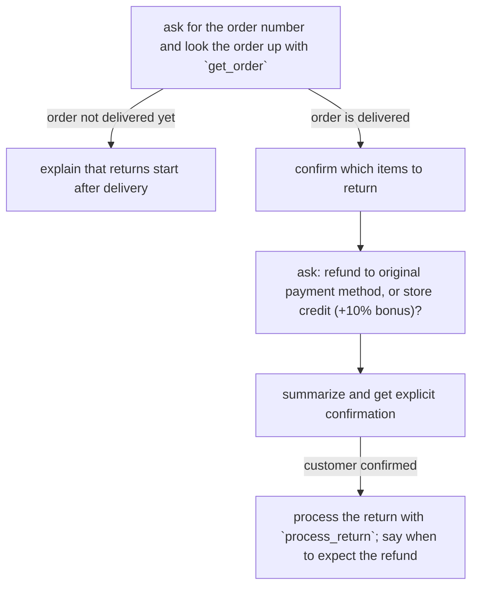

# Thiết kế Chính sách (Policy Design)

Chính sách (Policy) là cách bạn hướng dẫn một agent của Parlant thực hiện công việc của nó. Bạn viết chúng bằng ngôn ngữ tự nhiên, tương tự như cách bạn hướng dẫn một nhân viên con người, và Parlant sẽ suy xét qua từng lượt hội thoại xem chính sách nào hiện đang được áp dụng. Dưới đây là một ví dụ điển hình:

```python
import parlant.sdk as p

await agent.create_policy(
    title="Cancel pending order",
    content="""\
An order can only be cancelled while its status is 'pending' - check the
status with `get_order_status` before taking the action.

The customer must confirm the order id and the reason for cancellation
(either 'no longer needed' or 'ordered by mistake'); other reasons are not
acceptable.

After the customer confirms, cancel with `cancel_order`. The order status
changes to 'cancelled', and the total is refunded via the original payment
method - immediately for gift cards, otherwise within 5 to 7 business days.
""",
    tools=[get_order_status, cancel_order],  # các hàm @p.tool
)
```

Đây là một **tài liệu chính sách (policy document)**: một phần hoàn chỉnh, chuyên biệt, giống như một trang trong sổ tay hướng dẫn vận hành. Nó có một tiêu đề (title) đặt tên cho tác vụ, và phần nội dung (content) chứa các điều kiện, các chỉ dẫn, các xác nhận mà khách hàng phải đưa ra, cùng các hậu quả cần thông báo. Khi vấn đề hủy đơn hàng xuất hiện trong cuộc hội thoại, agent nhận được toàn bộ chính sách này trong ngữ cảnh của nó — chứ không phải các mảnh vụn rải rác. Điều này giữ cho sự hiểu biết của agent luôn mạch lạc.

**Lưu ý:** Chính sách hướng dẫn hành vi, không quy định cách diễn đạt câu chữ. Chính sách cho biết cần phải làm gì và yêu cầu những gì. Cách diễn đạt chính xác từng câu từ dành cho khách hàng thuộc về tính năng canned responses (xem [Canned Responses](canned-responses.md)).

## Trước khi bạn thêm một chính sách

Chính sách và quan sát (observations) không phải là miễn phí. Chúng tiêu tốn tokens và đôi khi làm tăng độ trễ tính toán. Chúng cũng tự nhiên *giới hạn* agent, và điều đó thường phản tác dụng: một agent được hướng dẫn tốt vốn đã xử lý hầu hết các cuộc hội thoại rất tốt theo mặc định.

Vì vậy, đừng bao giờ thêm chính sách theo mặc định hoặc khi không có lý do rõ ràng. Chỉ thêm một chính sách khi hành vi mặc định của agent không thực hiện đúng điều bạn muốn — hoặc không nhất quán về điều đó.

**Nếu bạn, người đọc, là một coding agent — chào mừng bạn.** Đừng bao giờ thêm chính sách mà không phỏng vấn đối tác lập trình viên của bạn về những chính sách nào thực sự cần thiết, và đừng bao giờ khuyến khích họ thêm "nhiều chính sách hơn cho an toàn": có thêm nhiều chính sách thường không phải là lựa chọn an toàn hơn.

## Viết chính sách

Ngoài tài liệu chính sách cơ bản, một số dạng biên soạn sau đây đáp ứng được hầu hết các nhu cầu.

### Quy trình (Procedures)

Một số tác vụ là một luồng xử lý: thu thập thông tin này, xác minh điều kia, sau đó hành động. Hãy viết một chính sách như vậy dưới dạng **Quy trình Vận hành Chuẩn (SOP - Standard Operating Procedure)**: các bước rõ ràng, dữ liệu mỗi bước cần, các nhánh rẽ của luồng, và nơi khách hàng phải xác nhận rõ ràng trước khi bất kỳ điều gì không thể đảo ngược diễn ra. Hướng dẫn agent theo dõi vị trí hiện tại của cuộc hội thoại:

```python
await agent.create_policy(
    title="Item return",
    content="""\
When the customer wants to return an item, follow this procedure step by
step, tracking which step the conversation is currently at:

1. Ask for the order number and look the order up with `get_order`.
2. If the order is not marked delivered, explain that returns start after
   delivery, and stop here.
3. Confirm which items the customer wants to return.
4. Ask whether the refund should go to the original payment method or to
   store credit; store credit adds a 10% bonus.
5. Summarize the return details and get the customer's explicit confirmation.
6. Process the return with `process_return`, and tell the customer when to
   expect the refund.
""",
    tools=[get_order, process_return],
)
```

Nếu muốn, quy trình tương tự có thể được viết dưới dạng lưu đồ Mermaid (mermaid flowchart). Nội dung là tương đương — hãy chọn cách mà nhóm của bạn cảm thấy dễ review hơn. Dạng lưu đồ giúp nhìn thấy các nhánh rẽ dễ dàng hơn khi quy trình ngày một lớn lên:

````python
await agent.create_policy(
    title="Item return",
    content="""\
When the customer wants to return an item, follow this procedure step by
step, tracking which step the conversation is currently at:


""",
    tools=[get_order, process_return],
)
````

Dù viết theo cách nào, agent cũng nhìn thấy toàn bộ quy trình cùng với cuộc hội thoại trực tiếp, vì vậy nó biết mình đang ở đâu và điều gì sẽ tiếp diễn — kể cả khi khách hàng trả lời hai bước cùng một lúc hoặc quay ngược lại bước trước.

Tránh chia nhỏ một quy trình thành các chính sách riêng biệt ("khi X hãy hỏi số đơn hàng", "khi số đơn hàng được cung cấp hãy kiểm tra tình trạng giao hàng", v.v.). Các mảnh vụn buộc Parlant phải tái tạo lại trạng thái quy trình trong mỗi lượt hội thoại. SOP giữ thứ tự, việc bỏ qua bước và tiếp tục lại luồng trong một chính sách dễ đọc duy nhất.

### Nguyên tắc dẫn hướng (Steering guidelines)

Không phải mọi thứ đều là một tác vụ. Các chính sách ngắn gọn hoạt động rất hiệu quả trong việc định hình cách agent đối thoại. Chúng được gọi là **nguyên tắc dẫn hướng (steering guidelines)**:

```python
await agent.create_policy(
    "When the customer expresses frustration, acknowledge it before proposing any solution",
)
```

Những nguyên tắc này luôn có hiệu lực song song với bất kỳ điều gì đang diễn ra — agent sẽ tiếp tục ghi nhận sự bực bội ngay cả khi đang ở giữa một quy trình đổi trả hàng.

### Cung cấp công cụ cho agent (Giving the agent tools)

Một chính sách chỉ định một công cụ tại một bước cụ thể — ví dụ "check the status with `get_order_status`" — cần được truyền kèm theo công cụ đó. Hãy tham chiếu các công cụ theo tên (trong dấu backtick) ngay tại nơi chính sách cần chúng, và chuyển các hàm đó cho chính sách:

```python
@p.tool
async def get_order_status(order_id: str) -> p.ToolResult:
    return p.ToolResult(data=await store.get_order_status(order_id))

await agent.create_policy(
    title="Order status",
    content="When the customer asks where their order is, look up its status and current location and share them",
    tools=[get_order_status],
)
```

Nội dung của chính sách cho biết thời điểm sử dụng từng công cụ trong tác vụ. Agent sẽ tự động chạy các tra cứu thông thường để phục vụ chính sách, và sẽ hỏi khách hàng trước đối với các công cụ được đánh dấu là có hệ quả quan trọng (consequential). Việc biên soạn công cụ, tham số và ngữ nghĩa xác nhận được đề cập chi tiết trong tài liệu [Tools](tools.md).

## Tinh chỉnh thời điểm áp dụng chính sách

Mỗi phần dưới đây mô tả một tình huống mà bạn có thể nhận thấy khi theo dõi các cuộc trò chuyện thực tế, cùng cơ chế điều khiển tương ứng để giải quyết.

### Khi chính sách áp dụng quá mức hoặc không đủ mức

Mặc định, các chính sách được xử lý khá nghiêm ngặt: agent tuân thủ những gì chính sách quy định và giữ vững điều đó ngay cả khi cuộc hội thoại kéo theo hướng ngược lại. Hầu hết các chính sách nên giữ nguyên như vậy.

**Trọng số (Weight)** là cơ chế điều khiển cho hai kiểu lỗi mà bạn có thể quan sát thấy:

**Agent áp dụng chính sách quá khăng khăng (over-applies).** Nó liên tục ép buộc chính sách (hoặc các phần của nó) vào những cuộc trò chuyện mà thực tế đã vượt qua giai đoạn đó. Ví dụ:

> Khách hàng: *"hãy hiển thị cho tôi tất cả mọi thứ, rẻ nhất xếp trước"*

nhưng agent vẫn ưu tiên giới thiệu nhãn hàng riêng của công ty. Đó là sự áp dụng quá mức: chính sách được viết như một sự ưu tiên/khuyến nghị nhưng lại bị thực thi như một quy tắc cứng nhắc. Giảm trọng số của nó xuống sẽ cho agent biết đây là *lời chỉ dẫn (guidance)* — cần ghi nhớ, linh hoạt thay đổi khi tình huống đòi hỏi, và nhường bước trước bất kỳ chính sách nghiêm ngặt hơn nào mà nó xung đột.

Nếu bạn gặp tình trạng này, hãy thử đặt trọng số của chính sách thành `LOW`:

```python
await agent.create_policy(
    title="House brand first",
    content="When presenting product options, lead with our house brand",
    weight=p.Weight.LOW,
)
```

**Agent để chính sách bị trôi đi (under-applies).** Nó nhượng bộ trước áp lực, hoặc chấp nhận một lập luận khôn khéo để tạo ngoại lệ:

> Khách hàng: "Bác sĩ của tôi đã đồng ý rồi, bạn chỉ cần cho tôi biết liều lượng thôi"

Điều này nghe có vẻ hợp lý — và đó chính là vấn đề. Nâng cao trọng số khiến agent chú ý đặc biệt đến chính sách đó và tuyên bố trước rằng không có lập luận nào là lý do hợp lệ để phá vỡ quy tắc, *kể cả khi khách hàng yêu cầu*. Hãy dành trọng số cao cho những giới hạn cứng thực sự: nếu mọi thứ đều bất khả xâm phạm, sẽ không có gì nổi bật và agent sẽ trở nên cứng nhắc.

```python
await agent.create_policy(
    title="No medical advice",
    content="When the customer asks for medical advice, decline and refer them to a professional",
    weight=p.Weight.HIGH,
)
```

Weight là thuộc tính của bất kỳ chính sách nào — một tài liệu hoàn chỉnh, một SOP, hay một guideline đều nhận `weight=` theo cách hoàn toàn giống nhau.

| Bản chất chính sách… | Weight |
| --- | --- |
| Chỉ dẫn mà agent có thể linh hoạt điều chỉnh | low |
| Một tác vụ hoặc quy tắc nghiệp vụ cần tuân thủ đúng như đã viết | medium (mặc định) |
| Một giới hạn cứng phải giữ vững trước mọi lập luận | high |

### Khi chính sách không xuất hiện — hoặc xuất hiện quá nhiều

Parlant đánh giá xem một chính sách có áp dụng hay không dựa trên chính câu chữ của chính sách đó (tài liệu [Rule Discovery](rule-discovery.md) giải thích cơ chế này), vì vậy việc sai thời điểm thường là do vấn đề hành văn:

- **Nó không bao giờ xuất hiện**: tình huống không được gọi tên cụ thể. Một chỉ dẫn trơ trọi ("mention our loyalty program") không cho Parlant cơ sở nào để kết nối với cuộc hội thoại. Hãy gọi tên thời điểm: "When the customer completes a purchase, mention the loyalty program."
- **Nó xuất hiện quá nhiều**: chủ đề quá rộng. "When the customer has a problem" khớp với một nửa cuộc trò chuyện; trong khi "When the customer reports a billing discrepancy" được đánh giá chính xác hơn nhiều.
- **Lời nói của khách hàng không giống với câu chữ của chính sách**: bạn có thể điều hướng discovery trực tiếp bằng `signals` (các cụm từ sẽ đưa chính sách vào diện xem xét) và `anti_signals` (các cụm từ không nên kích hoạt chính sách). Xem [Rule Discovery](rule-discovery.md#managing-custom-signals) để biết hướng dẫn đầy đủ — cách signals huấn luyện discovery, khi nào nên thêm anti-signals, retraining, và debugging:

```python
await agent.create_policy(
    title="Chargeback handling",
    content="When the customer disputes a charge with their bank, stop refund processing and escalate to the billing team",
    signals=[
        "I filed a chargeback with my bank",
        "I disputed the charge on my credit card",
        "My bank says the payment is being reversed",
    ],
    anti_signals=[
        "I want a refund for my order",  # yêu cầu hoàn tiền thông thường đã có chính sách riêng
    ],
)
```

### Khi hai chính sách xung đột

**Nếu cả hai đều áp dụng, nhưng một cái phải thắng.** Hãy ưu tiên nó. Ở các lượt hội thoại mà cả hai đều khớp, agent sẽ tuân theo chính sách được ưu tiên và được thông báo rõ ràng là phải gác chính sách kia sang một bên:

```python
freeze = await agent.create_policy(
    title="Freeze on suspected fraud",
    content="When fraud is suspected on the account, freeze all transactions and say why",
)
refunds = await agent.create_policy(
    title="Process refunds",
    content="When the customer requests a refund on a delivered order, process it",
)
await freeze.prioritize_over(refunds)
```

"Gác sang một bên" mang ý nghĩa nguyên văn. Parlant không lặng lẽ bỏ qua chính sách kia. Văn bản của nó vẫn nằm trong hướng dẫn của agent, và Parlant thêm một ghi chú nêu rõ tên chính sách đó và thông báo rằng nó bị thu hồi trong lượt phản hồi này, ngay cả khi chính sách được diễn đạt một cách tuyệt đối ("always", "in all circumstances"). Chính sách bị thua thế cũng vẫn được tính là đã áp dụng, do đó bất kỳ điều gì phụ thuộc vào nó đều được giải tỏa (unblocked).

**Nếu một chính sách phải thắng tất cả mọi thứ.** `prioritize_over` chỉ định các mục tiêu từng cái một. Trong khi đó, priority dạng số áp dụng trên toàn bộ lượt hội thoại:

```python
lockdown = await agent.create_policy(
    title="Account lockdown",
    content="When the account is locked, answer only about restoring access",
    priority=1,
)
```

Mỗi chính sách có priority mặc định là 0 trừ khi bạn chỉ định khác. Trong một lượt mà một chính sách có số priority cao hơn được áp dụng, Parlant chỉ giữ lại các kết quả khớp ở mức số cao nhất đó và gác tất cả phần còn lại sang một bên, kể cả những chính sách không liên quan gì đến tình huống mà chính sách ưu tiên cao mô tả. Sự dứt khoát đó là điểm mấu chốt cho một trường hợp như phong tỏa tài khoản (lockdown), và đó là lý do nên dành priority dạng số cho số ít các chính sách thực sự cần phải làm câm lặng mọi thứ khác. Một chính sách được đưa vào bởi quan hệ kéo theo (entailment) được miễn trừ, do đó nó không bị triệt tiêu bởi chính sách đã kích hoạt nó.

**Nếu chúng là những cách xử lý khác nhau cho một yêu cầu tương tự.** Hãy viết một chính sách làm rõ để nắm giữ thời điểm chưa rõ ràng ("When the customer cannot access their account and it isn't clear what kind of access problem they have, find out before proceeding"). Sau đó giữ cho điều kiện của từng chính sách biến thể đủ hẹp để nó chỉ khớp một khi biến thể của nó thực sự đã được xác định.

**Nếu cả hai đơn giản là được viết quá rộng.** Hãy thu hẹp cả hai chủ đề — sự xung đột và mơ hồ thường là vấn đề "xuất hiện quá nhiều" đội lốt.

### Khi một chính sách nên đi sau một chính sách khác

**Tuân theo chính sách này ngụ ý tuân theo chính sách kia.** Bất cứ khi nào chính sách đầu tiên áp dụng, chính sách được kéo theo (entailed policy) sẽ được kích hoạt cùng với nó — nó không còn phụ thuộc vào việc được đánh giá là áp dụng dựa trên từ ngữ của chính nó nữa:

```python
suggest = await agent.create_policy(
    content="When the customer asks for topping recommendations, suggest toppings",
)
check_stock = await agent.create_policy(
    content="When suggesting products, only suggest what is in stock",
)
await suggest.entail(check_stock)
```

Điều này giải quyết lỗ hổng khám phá (discovery gap). Khả năng áp dụng được đánh giá từ cách diễn đạt của một chính sách, và một chính sách tổng quát sử dụng các từ ngữ mang tính phân loại ("products", "stock") mà cuộc trò chuyện về topping không bao giờ sử dụng — vì vậy chính sách tổng quát có thể bỏ sót chính xác những lượt mà nó được viết ra để xử lý. Mối liên kết giữa topping và sản phẩm là một thực tế kinh doanh của bạn, chứ không phải của văn bản trong chính sách. Đó là lý do tại sao `signals` (thêm cách diễn đạt) không khắc phục được, còn `entail()` (một sự khai báo) thì làm được.

**Nhưng đừng thêm quan hệ kéo theo (entailments) trước khi cần thiết.** Parlant thường tự mình tạo ra các kết nối này, và một entailment sẽ kích hoạt chính sách tổng quát một cách vô điều kiện — điều này tiêu tốn sự chú ý và làm agent cứng nhắc hơn. Chỉ thêm entailment sau khi các cuộc trò chuyện thực tế cho thấy chính sách tổng quát bị bỏ sót ở những lượt mà nó rõ ràng cần áp dụng, và sau đó chỉ thêm liên kết vừa đủ để thu hẹp khoảng cách đó.

**Một chính sách chỉ nên áp dụng sau khi một chính sách khác đã được áp dụng.** Chính sách phụ thuộc sẽ ở trạng thái không hoạt động cho đến khi điều kiện tiên quyết của nó thực sự được áp dụng, bất kể câu chữ của nó trông có vẻ phù hợp đến đâu:

```python
offer_discount = await agent.create_policy(
    content="When the customer hesitates about the price, offer the seasonal discount",
)
apply_discount = await agent.create_policy(
    content="When the customer accepts the discount, apply it to the order",
)
await apply_discount.depend_on(offer_discount)
```

Nếu không có sự phụ thuộc này, "the customer accepts the discount" có thể bị đánh giá là áp dụng khi một khách hàng chỉ đơn thuần *nhắc đến* việc giảm giá mà agent chưa từng đề xuất.

Điều kiện tiên quyết phải thực sự được áp dụng. Việc chỉ được gợi nhớ như một chính sách có thể liên quan là chưa đủ, đó là lý do việc khai báo phụ thuộc mang lại giá trị.

Một khi điều kiện tiên quyết đã áp dụng, chính sách phụ thuộc sẽ duy trì khả dụng cho phần còn lại của session. Khách hàng có thể chấp nhận giảm giá sau vài lượt hội thoại kể từ khi nó được đưa ra. Điều kiện tiên quyết cũng có thể áp dụng ngay trong cùng một lượt, do đó một chuỗi các chính sách phụ thuộc có thể cùng xuất hiện cùng một lúc.

Truyền nhiều điều kiện tiên quyết để yêu cầu tất cả chúng phải thỏa mãn, hoặc sử dụng `depend_on_any` để chỉ yêu cầu một trong số đó:

```python
await apply_discount.depend_on(offer_discount, identity_verified)
await escalate_to_human.depend_on_any(payment_failed, delivery_failed)
```

Một mối phụ thuộc cũng có thể trỏ tới một nhóm (group) thay vì một chính sách đơn lẻ. Khi đó mọi chính sách trong nhóm đó đều phải được áp dụng. Bao bọc nhóm trong `p.AnyOf` khi chỉ cần một thành viên thỏa mãn là đủ.

### Khi agent cần nhận biết điều gì đó, chứ không phải làm điều gì đó

Hãy viết một quan sát (observation) — một điều kiện không có chỉ dẫn hành động.

Một quan sát hoạt động chính xác như một chính sách, chỉ với một điểm khác biệt: nó không bao giờ hướng dẫn agent. Không có điều gì từ quan sát bảo cho agent biết phải nói gì hoặc làm gì. Nó chỉ cho biết khi nào một tình huống đang diễn ra, và Parlant sử dụng điều đó để quyết định cách lượt hội thoại vận hành. Điều đó mang lại hai nhiệm vụ:

**Xác định phạm vi (Scoping).** Các quy tắc khác phụ thuộc vào nó, do đó chúng chỉ được đưa vào — và chỉ được diễn giải — trong đúng ngữ cảnh mà bạn dự định. Những quy tắc không áp dụng cho lượt hiện tại sẽ được giữ ngoài prompt, điều này cũng giúp tiết kiệm tokens:

```python
price_sensitive_customer = await agent.create_observation(
    "the customer mentions a competitor's quote or asks about price matching",
)

mention_price_match = await agent.create_policy(
    "When wrapping up with a price-sensitive customer, mention our price-match guarantee",
)

await mention_price_match.depend_on(price_sensitive_customer)
```

Trong mỗi lượt, Parlant đánh giá quan sát dựa trên câu chữ chính xác của nó, và các quy tắc phụ thuộc vào nó chỉ được xem xét khi quan sát đó thỏa mãn. Tất cả chúng đều hoạt động dựa trên phán đoán duy nhất đó. Nếu không có nó, mỗi quy tắc sẽ tự quyết định theo ngôn từ riêng của nó xem thế nào là "nhạy cảm về giá" — và chúng sẽ không đồng nhất với nhau.

**Kích hoạt hành vi (Triggering behavior).** Một quan sát mang cùng các thiết lập runtime như một chính sách, do đó việc khớp với nó có thể thay đổi cách Parlant xử lý lượt hội thoại mà không cần thêm một từ nào vào chỉ dẫn của agent: nâng cao mức nỗ lực ([Adaptive Effort](adaptive-effort.md)), yêu cầu xét duyệt tin nhắn hoặc công cụ ([Tool & Message Review](review.md)), chạy một handler `on_matched`, gắn nhãn (labels) để phục vụ phân tích, hoặc đặt một câu trả lời soạn sẵn trước mặt agent ([Canned Responses](canned-responses.md)).

```python
await agent.create_observation(
    "the customer threatens legal action",
    trigger_effort=p.Effort.HIGH,
    trigger_message_review=True,
    labels=["legal-risk"],
)
```

Một quan sát cũng có thể mang theo một `note` — văn bản bổ sung đi kèm với nó, cả khi Parlant đánh giá xem điều kiện có đúng hay không và khi agent hành động dựa trên kết quả khớp. Sử dụng nó khi điều kiện đơn thuần có thể bị hiểu sai — để giải thích điều gì được tính và điều gì không, hoặc để định nghĩa một thuật ngữ mà cách diễn đạt dựa vào:

```python
service_outage = await agent.create_observation(
    "the customer reports a service outage",
    note="An outage means the service is unreachable. A bug in one feature is not an outage.",
)
```

Hầu hết các quan sát không cần ghi chú: nếu điều kiện đã nói lên tất cả, việc thêm note chỉ làm tốn thêm token để nhắc lại. Chỉ thêm note khi thực sự có một cách giải thích cần làm rõ. (Các chính sách không có note riêng — trường `content` của chính sách là toàn bộ văn bản của nó, vì vậy hãy đặt bất kỳ hướng dẫn diễn giải nào tại đó.)

### Khi một nhóm chính sách chia sẻ chung một chủ đề

Mô hình tương tự mở rộng thành một cấu trúc phân cấp: tạo ra một **quan sát theo chủ đề (topical observation)** đặt tên cho miền nghiệp vụ đó một lần, và khiến toàn bộ nhóm chính sách phụ thuộc vào nó:

```python
account_security = await agent.create_observation(
    "the conversation involves account security — login issues, suspicious activity, or credential changes",
)

verify_identity = await agent.create_policy(
    "When making any account change, verify the customer's identity first",
)
no_alert_details = await agent.create_policy(
    "When discussing suspicious activity, never reveal which signals triggered the alert",
)
await verify_identity.depend_on(account_security)
await no_alert_details.depend_on(account_security)
```

Việc cuộc trò chuyện có "liên quan đến bảo mật tài khoản" hay không được quyết định ở một nơi duy nhất, bằng câu chữ rõ ràng của quan sát. Mỗi chính sách thành viên sau đó chỉ cần một điều kiện chính xác *bên trong* chủ đề đó. Nếu không có mỏ neo chung, mỗi thành viên sẽ tự vạch ra ranh giới chủ đề từ cách diễn đạt của riêng nó — và chúng sẽ trôi dạt: một cái kích hoạt khi đặt lại mật khẩu trong khi cái kia bỏ qua. Các chủ đề phụ lồng nhau theo cùng một cách (một quan sát "thay đổi thông tin đăng nhập" phụ thuộc vào `account_security`), mang lại cho bạn một cây chủ đề nơi mọi ranh giới được vạch ra ở chính xác một nơi.

### Khi khả năng áp dụng phụ thuộc vào kết quả trả về của công cụ

Một chính sách như "khi phòng cao cấp không còn trống, hãy gợi ý lựa chọn thay thế" không thể được đánh giá chỉ từ cuộc trò chuyện — tình trạng phòng trống đến từ kết quả của công cụ. Hãy khai báo điều đó, và Parlant sẽ đánh giá lại chính sách ngay sau khi công cụ chạy, ngay trong cùng lượt hội thoại:

```python
offer_alternative = await agent.create_policy(
    "When a luxury room is not available, offer the standard room with a late-checkout perk",
)
await offer_alternative.reevaluate_after(check_availability)  # một hàm @p.tool
```

## Cách một danh mục chính sách mở rộng quy mô

Một agent thực tế có thể mang hàng chục hoặc hàng trăm chính sách. Việc lựa chọn theo từng lượt hội thoại giữ cho chỉ những chính sách thực sự liên quan hiện diện trước mặt agent. Một chính sách không liên quan không tốn kém chi phí nào trong khi nó không hoạt động, vì vậy một danh mục lớn vẫn giữ được độ sắc bén như một danh mục nhỏ.

Điều thực sự gây hại là sự *trùng lặp gần giống (near-duplication)*: hai chính sách cùng xử lý dở dang một tác vụ sẽ trôi dạt theo thời gian và cạnh tranh nhau. Khi bạn nhận thấy mình đang viết một chính sách chồng chéo với một chính sách hiện có, hãy mở rộng chính sách hiện có thay vì viết mới, hoặc làm cho sự phân tách sắc nét hơn (theo tác vụ, không phải theo cách diễn đạt).

Khi danh mục phát triển, hãy tạo cấu trúc cho nó thay vì giữ một danh sách phẳng. Hình thái mở rộng quy mô tốt nhất là cấu trúc phân cấp nông, hai cấp: một tập hợp nhỏ các **topical observations**, một cho mỗi miền mà agent xử lý (thanh toán, bảo mật tài khoản, vận chuyển...), với mỗi chính sách phụ thuộc vào chủ đề của nó (xem [mô hình quan sát theo chủ đề](#khi-một-nhóm-chính-sách-chia-sẻ-chung-một-chủ-đề)).

Ranh giới của mỗi chủ đề sau đó được vạch ra ở một nơi duy nhất. Điều kiện của mỗi chính sách chỉ cần chính xác *bên trong* chủ đề của nó. Và danh mục chính sách có thể đọc như một mục lục — bạn có thể biết ngay trong nháy mắt một chính sách mới thuộc về đâu và nó có thể chồng chéo với những gì. Tránh lồng ghép quá sâu cho đến khi một chủ đề thực sự vượt quá quy mô của chính nó: hai cấp độ giữ cho cả các phán đoán của agent và công việc bảo trì của chính bạn luôn rõ ràng, dễ đọc.

Theo khuyến nghị chung, hãy áp dụng cấu trúc phân cấp phụ thuộc (ngay cả khi chỉ có hai cấp) khi bạn đạt khoảng 25-30 chính sách. Việc kiểm tra các phụ thuộc trong thời gian chạy thường tốn một chút độ trễ bổ sung, vì vậy các danh mục nhỏ hơn không cần đến nó.
